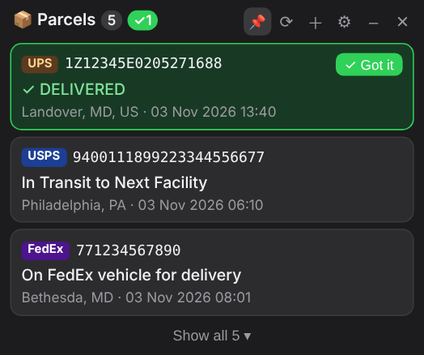

# Parcel Widget

> **macOS only for now** (macOS 11+, Apple Silicon or Intel). A Windows version is planned.

A little animated character on your macOS desktop who does small jobs for you and reports in a comic speech balloon.
Her first jobs: finding tracking numbers in your Gmail and checking them on [parcelsapp.com](https://parcelsapp.com),
and a CPU / memory / network monitor drawn as candlestick charts.



## How it works
1. **At launch** she runs each job once and reports in her speech balloon (step by step while it runs:
   reading Gmail, asking parcelsapp, what changed). Confirm each report with its button.
   Every check is remembered (time + result, `memory.json`): if the widget restarts before the next
   scheduled check is due, she shows the last result instead of checking again.
2. **Then she goes idle** and the jobs keep running on their own schedule. Parcels are checked
   every 90 minutes from 09:00 to 19:00 (changeable); the balloon only pops up again when something changes.
   Nothing runs while the Mac sleeps. When it wakes up she checks once, quietly, unless the last check
   is still current. If the network isn't back yet she retries up to 3 times, 3 minutes apart.
3. **Idle**: hover over her for a button per job (📦 packages, 📊 system monitor, 👉 poke).
   Click her to poke her; drag her to move her.
4. **Right-click her** (or click the menu bar icon) for the menu: one submenu per job, Show Widget,
   Settings…, Quit. Everything detailed is in the **Settings** window.

## Features
- 📦 **Parcels**: scans Gmail (read-only, IMAP + app password) for **UPS, FedEx, USPS and Amazon** tracking numbers,
  reads the latest event from parcelsapp.com with a real browser (Playwright); delivered ones get a **✓ Got it** button.
  Add a number right in her balloon (hover → 📦, or menu → Parcels → Add Tracking Number…);
  archived ones, the schedule, Gmail and browser are in Settings → Parcels
- 📊 **System monitor**: CPU, memory, download and upload as candlestick charts (5 s – 1 min per candle,
  red-up or green-up colors)
- 🔌 **USB**: lists what's plugged in over USB and the driver running each device (bundle, version, kext or
  DriverKit), then checks online whether the driver is current. Apple's drivers come with macOS, so she asks
  Software Update whether a newer macOS is out; for other vendors' drivers she looks the vendor up in the public
  USB ID database and searches the web (a version number found there is a hint, with the links to check it).
  Nothing is updated for you. A **USB printer** that isn't in the printer list: AirPrint printers need no driver;
  otherwise she looks for its driver on the Mac, then in Apple's printer driver catalog (matched by model),
  and downloads it from Apple to `~/Downloads/Printer Drivers` (you install it). Plugged-in devices are noticed within 30 s
- 🖨 **Printers & AirPrint** (Settings → 🖨 Printers): the printer list grouped by physical printer. One click
  sets a printer up with AirPrint (no driver: macOS asks the printer what it can do) - network printers by
  address or found nearby, USB printers too. The same printer is often in the list two or three times (a generic
  driver, an entry gone offline); she keeps the AirPrint one and removes the others when you confirm. macOS may
  ask for your password to change the printer list.
- 👉 **Poke**: a random move and a line
- Animated **skins**, and **custom skins** an image AI draws from your description or picture
- Screen-size presets, keep on top, English / 中文, lives in the **menu bar** (no Dock icon)

## Install
### Option A: the app (DMG)
1. Download `ParcelWidget-<version>-macOS-arm64.dmg` from [Releases](https://github.com/cxlgo64/ParcelWidget/releases)
   (Apple Silicon; on an Intel Mac build it yourself, see below).
2. Open it and drag **Parcel Widget** into **Applications**.
3. The app isn't signed by Apple, so the first time: right-click it → **Open** → **Open**
   (or System Settings → Privacy & Security → **Open Anyway**).
4. She appears on your desktop and a parcel icon appears in the menu bar. Right-click her → **Settings…** →
   📦 Parcels to connect Gmail with an [app password](https://myaccount.google.com/apppasswords)
   (2-Step Verification must be on).

Parcel lookups use your installed **Google Chrome** by default (change it in Settings → Parcels).
To start it at login: System Settings → General → Login Items → ＋ → Parcel Widget.

### Option B: from source
Requires Python 3.9+.

```bash
git clone https://github.com/cxlgo64/ParcelWidget.git
cd ParcelWidget
chmod +x *.command
./install.command      # creates .venv, installs deps + Chromium, starts at login
```

- Start manually: `./start.command`
- Remove auto-start: `./uninstall_autostart.command`

### Build the DMG yourself
```bash
./packaging/build_mac.sh     # -> dist/ParcelWidget-<version>-macOS-<arch>.dmg
```

## Skins
A skin is a folder in `ui/skins/<id>/` with a sprite sheet and a `skin.json` describing it:

```json
{
  "name": "My Character", "sheet": "sheet.png", "thumb": "thumb.png",
  "cell": [192, 208],          // size of one frame in the sheet
  "display_height": 116,       // base on-screen height (x1.25, then the screen-size zoom)
  "anims": { "idle": {"row": 0, "frames": [0], "fps": 4, "loop": true}, ... }
}
```

Animations the widget uses: `idle`, `blink`, `fidget`, `walk_left`, `walk_right`, `wave`, `jump`,
`doze`, `sleep`, `wake`, `cheer`, `think`, `shy`, `look_left`, `look_right`, `look_around`
(missing ones are simply skipped).

| When | She… |
|---|---|
| Idle | blinks, fidgets, looks around |
| Mouse on her balloon | turns to read it with you |
| A job is running | thinks |
| A report arrives | delivered: jumps + cheers; new package: cheers; a failure: shy |
| Click her (poke) | waves, jumps, cheers or gets shy, and says something |
| Dragging the window | runs in the drag direction |
| 5 min without mouse activity | dozes off; move the mouse to wake her |

> Only commit skin artwork you have the rights to share.

### Custom skins (image AI)
Settings → **🎨 Custom skin** (or ＋ next to the characters in Settings → General): give a name, a description
and optionally a reference picture, pick an image AI and enter its API key (stored in the macOS Keychain).
About 10 image requests make a base character plus one row of poses per animation; the widget removes the
green background, cuts and aligns the poses and switches to the new skin.

| Provider | Key | Reference picture |
|---|---|---|
| OpenAI gpt-image (or any OpenAI-compatible endpoint) | API key | ✓ |
| Google Gemini image | API key | ✓ |
| Qwen (Alibaba Model Studio) | DashScope API key | ✓ |
| MiniMax image-01 | API key | ✓ |
| Tencent Hunyuan | `SecretId:SecretKey` | – |
| Stability AI | API key | style only |
| Replicate / fal.ai | token / key | ✓ (depends on model) |

Model names and endpoints can be changed under "Advanced". From the command line:
`.venv/bin/python -m skinmaker --help` (make, redo some rows, reassemble, preview).
With Claude Code, the `make-skin` skill in `.claude/skills/` knows how to make, check, fix and tune skins.

## Privacy
- Your Gmail app password is stored in the **macOS Keychain**, never in a file. macOS may ask once
  whether Parcel Widget may read it (choose **Always Allow**); a new version of the app asks once again.
- Shipments, settings and logs live in `~/Library/Application Support/ParcelWidget/`, outside this repo.
- The USB check sends vendor and product names (not serial numbers) to DuckDuckGo to search for drivers,
  and downloads driver lists and printer drivers only from Apple's servers (and linux-usb.org's ID list).

## Recognized tracking numbers
| Carrier | Pattern |
|---|---|
| UPS | `1Z` + 16 characters |
| Amazon | `TBA` + 12 digits |
| USPS | 22/26 digits starting with 92–95, or `XX123456789US` |
| FedEx | 12/15/20/22 digits (only if the email mentions FedEx) |

Many Amazon emails only contain a "Track package" button with no number. Add those in her balloon (hover over her → 📦).

## Troubleshooting
- **"Blocked" / "No data"**: pick another browser in Settings → Parcels, or untick "Run the browser in the background".
- **Debug one number** (quit the widget first):
  `.venv/bin/python debug_track.py 1Z999AA10123456784 --browser firefox`
- **Logs**: Settings → 📝 Log (live, filter by checks / errors), or `~/Library/Application Support/ParcelWidget/widget.log`
- **Tests**: `.venv/bin/python -m pytest test_parser.py`

## Project layout
| File | What it does |
|---|---|
| `app.py` | Windows, scheduler loop, JS ↔ Python API |
| `core.py` | Paths, config, log, Keychain, skins, size presets |
| `power.py` | Sleep / wake of the computer (macOS) |
| `features/` | The character's jobs: `parcels.py`, `sysmon.py`, `usb.py`, `poke.py` (how to add one: `features/__init__.py`) |
| `usbscan.py` | USB devices, their drivers and the printers (macOS: ioreg, kmutil, CUPS) |
| `airprint.py` | The printer list grouped by printer, one-click AirPrint, duplicates (macOS: CUPS lpadmin, ipptool) |
| `driverinfo.py` | Online lookups for the USB check: USB IDs, Software Update, web search, Apple's printer drivers |
| `reports.py` | Reports shown in her balloon until confirmed |
| `menus.py` | The menu as data (menu bar icon and right-click) |
| `menubar.py` | macOS menu bar icon, right-click menu |
| `mail_scanner.py` | Gmail IMAP scan |
| `tracking_parser.py` | Tracking-number regexes, delivered detection |
| `tracker.py` | parcelsapp lookup via Playwright |
| `db.py` | SQLite storage |
| `skinmaker/` | Custom skin generation: image providers + sprite sheet pipeline |
| `ui/index.html` | The character, her balloon and hover buttons; each job's page side (`FEATURES`) |
| `ui/settings.html` | The settings window |
| `ui/i18n.js` | English / 中文 strings |
| `packaging/` | Building the macOS app + DMG (PyInstaller) |

## License
MIT
